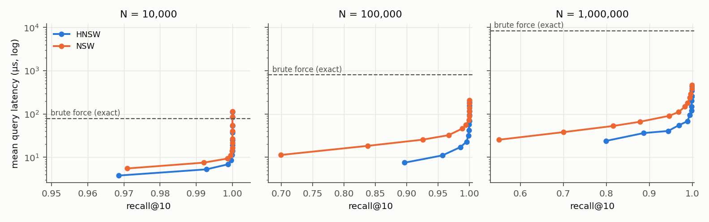

# HNSW Vector Search Engine (EE538 Phase II)

A C++17 approximate nearest-neighbour (ANN) search engine built around a from-scratch
**Hierarchical Navigable Small World** graph (Malkov & Yashunin, TPAMI 2018). Given N
d-dimensional float vectors it answers top-k queries under **L2, cosine or inner product**,
supports **insert, delete (tombstones + local neighbour repair), compaction, save/load**, and
ships with an exact **brute-force reference index**, a **single-layer NSW baseline**, a
command-line interface, a 44-case unit-test suite plus end-to-end golden tests, and a
reproducible experiment pipeline.

Track B (LLM/MLSys module): the module is the retrieval index; embeddings are replaced by a
documented, seeded synthetic generator (and optionally SIFT1M).

| | |
|---|---|
| **Team** | Jing Ren · Zhuoshen Cheng · Ruibo Yang |
| **Language / build** | C++17, GNU Make (primary) or CMake ≥ 3.16; no third-party libraries |
| **Report** | [`docs/report.pdf`](docs/report.pdf) (5-page main body + appendix), source [`docs/report.md`](docs/report.md); rebuild with `python3 scripts/build_report_pdf.py` |
| **Results** | [`results/full/tables.md`](results/full/tables.md), figures in [`results/full/figures/`](results/full/figures) |

---

## Headline results (Apple M4, single thread; details in the report)

| | |
|---|---|
| 1M clustered vectors, d = 128 | recall@10 = 0.99 in 95 µs/query vs 8.4 ms brute force (**88×**), 712 B/vector, 185 s build |
| SIFT1M (published ground truth) | recall@10 0.990 at 163 µs (p99 209 µs), 0.997 at 297 µs |
| Hierarchy (HNSW vs NSW) | 2.4× fewer distance computations at 1M for recall 0.99; equal at 10K |
| Neighbour heuristic | needed on clustered data: simple selection plateaus at recall 0.985 |
| M / efc | M = 16, efc = 200 is the knee: within 6 % of the best latency at 0.99 with 26 % less memory than M = 48 |
| Deletions (50 % deleted, hubs first) | tombstones: 3.1× latency; repair-prune: recall 0.923; truncating repair strands 205 nodes (recall 0.86); final repair: recall 0.985 = rebuild, every node reachable. Same ordering on SIFT (repair 0.903 vs rebuild 0.893 at ef = 16) |
| Kernels / top-k | NEON 3.8× (d = 128) and 7.8× (d = 960) over scalar; bounded heap 2.2–2.8× faster than quickselect |



## 1. Quick start

```bash
make -j8                  # builds build/bin/{hnsw_cli,hnsw_gen,hnsw_bench,hnsw_tests}
make test                 # unit tests + golden end-to-end tests
./build/bin/hnsw_cli      # interactive shell (type `help`)
```

A complete session (this is `tests/golden/demo.cmds`; its exact expected output is
`tests/golden/demo.expected`):

```text
> build tests/data/tiny.csv --metric l2 --M 4 --efc 16
built hnsw(l2, d=2, M=4, M0=8, efc=16, heuristic, repair) with 8 vectors
> query tests/data/tiny_queries.csv --k 3 --ef 16 --exact
q0: (3, 0.05) (1, 0.65) (2, 0.85)
q1: (4, 0.0499999) (5, 0.65) (6, 0.85)
q2: (7, 2) (5, 13) (6, 13)
summary: 3 queries, k=3, ef=16, recall@3 1.0000
> delete 3
deleted 1 id (live: 7)
> save tests/tmp/tiny.idx
...
```

Larger example with generated data:

```bash
./build/bin/hnsw_gen --out data/demo --type clustered --n 100000 --nq 1000 --dim 128
./build/bin/hnsw_cli
> build data/demo_base.fvecs --metric l2 --M 16 --efc 200
> query data/demo_query.fvecs --k 10 --ef 50 --gt data/demo_gt.ivecs
> delete 312
> query data/demo_query.fvecs --k 10 --ef 50 --exact     # recall against the live set
> stats
> save data/demo.idx
```

## 2. Build

| Item | Value |
|---|---|
| Standard | C++17 (`-std=c++17`), no compiler extensions required |
| Tested compiler | Apple clang 21.0.0 (arm64, macOS 26); the code also targets g++ ≥ 9 / clang ≥ 10 on Linux |
| Flags | `-O3 -Wall -Wextra -Wpedantic -Wshadow -Wnon-virtual-dtor -Woverloaded-virtual -Wcast-align -Wnull-dereference -Wold-style-cast -Wformat=2` (+ `-march=native` on x86-64); builds warning-free |
| Dependencies | C++ standard library and POSIX only. Python 3 + matplotlib for plotting only |
| SIMD | NEON on arm64, AVX2(+FMA) on x86-64, unrolled scalar otherwise; `make scalar` builds with `-DHNSW_FORCE_SCALAR` |

```bash
make -j8                               # optimised build in build/
make asan                              # ASan + UBSan build in build-asan/, runs all tests
make clean
cmake -S . -B cbuild && cmake --build cbuild -j && ctest --test-dir cbuild   # CMake alternative
```

> The machine used for development had no CMake installed, so `CMakeLists.txt` mirrors the
> Makefile but was not exercised there; the Makefile is the verified build.

## 3. Command-line interface

`hnsw_cli [--keep-going] [--no-timing] [--no-echo] [script]` reads commands interactively, from a
script file, or from stdin. Exit code 0 = every command succeeded, 1 = a command failed (scripts
stop at the first failure unless `--keep-going`), 2 = bad program arguments.

| Command | Purpose |
|---|---|
| `build <file> [--index hnsw\|nsw\|bruteforce] [--metric l2\|ip\|cosine] [--M 16] [--M0 2M] [--efc 200] [--seed 42] [--select heuristic\|simple] [--delete-policy repair\|repair-prune\|repair-fixed\|tombstone] [--limit N] [--start-id 0]` | build a new index (replaces the current one only on success) |
| `new <dim> [index options]` | empty index |
| `insert <file> [--limit N] [--start-id ID]` | add a file of vectors (all-or-nothing) |
| `add <id> <v1,...,vd>` / `upsert <id> <v1,...,vd>` | add / insert-or-replace one vector |
| `delete <id> [<id> ...]` | delete ids (all-or-nothing) |
| `query <file> [--k 10] [--ef 50] [--limit N] [--show 10] [--gt gt.ivecs \| --exact] [--out res.csv]` | batch k-NN with latency summary and recall@k |
| `search <v1,...,vd> [--k] [--ef]` | one ad-hoc query |
| `save <path>` / `load <path>` | atomic persistence with checksum |
| `info`, `stats`, `check`, `compact` | summary, structure/memory statistics, invariant check, rebuild without tombstones |
| `set <k\|ef\|timing\|echo> <value>`, `help [cmd]`, `quit` | session settings |

Input formats: `.fvecs` (TEXMEX; ids = row numbers + `--start-id`) and `.csv` (`id,v1,...,vd`,
`#` comments allowed). Ground truth: `.ivecs`. Invalid input (missing file, truncated file,
inconsistent dimensions, NaN/inf, duplicate ids, zero vector under cosine, unknown options,
malformed numbers, corrupt index files) produces `error: <message>`, a non-zero exit status in
script mode, and **an unchanged index**.

## 4. Tests

```bash
make test        # = scripts/run_tests.sh build
make asan        # same tests under AddressSanitizer + UndefinedBehaviorSanitizer
leaks --atExit -- ./build/bin/hnsw_tests     # macOS leak check (LeakSanitizer is unavailable on macOS/arm64)
```

| Suite | What it checks |
|---|---|
| `tests/test_containers.cpp` (12) | `MinHeap`/`BoundedMaxHeap` vs `std::multiset`/sort under 20k random ops with heap-order checks; `OpenHashMap` vs `std::unordered_map` under 50k ops, a constant hash forcing one 40-key probe chain, backward-shift deletion, growth, invariant checker; quickselect vs sort on random/sorted/reversed/constant/few-distinct inputs; visited-table epoch wrap-around; `VectorStore` self-aliasing add |
| `tests/test_distance_bruteforce.cpp` (6) | SIMD vs scalar kernels for d = 1…1000, bit-exact symmetry, cosine zero-vector rejection; brute force vs an independent `std::sort` linear scan for all metrics × all top-k methods; ties by id; swap-remove |
| `tests/test_hnsw.cpp` (15) | recall@10 ≥ 0.95 vs exact search for all metrics; **exact equality** with brute force when ef ≥ N; level distribution ≈ 1/M; full invariant check; seed determinism; N = 0/1, k = 0, k > N; duplicates and ties; all error paths leave the index unchanged; 6000-step seeded insert/delete/query interleaving vs a reference under all four in-place delete policies; deleting the entry point until empty and re-inserting; deleting hubs (graph stays reachable); repair vs tombstone edge counts; compaction equals a fresh build; NSW and simple-selection variants; heuristic vs simple on clustered data |
| `tests/test_persistence_io.cpp` (6) | save→load→identical answers for 2 kinds × 3 metrics; insert-after-reload equals insert-without-reload (RNG state persisted); truncation at 9 offsets, flipped byte, bad magic, bad version, trailing bytes, missing file; failed save keeps the old file; fvecs/ivecs/CSV parsing and errors |
| `tests/test_cli.cpp` (5) | parser, the full workflow, ~20 failing commands that must leave the index unchanged, ground-truth recall and CSV output, script exit codes |
| `tests/golden/demo.cmds` → `demo.expected` | complete application input with expected output (build, query, delete, re-add, upsert, save/load, delete-all, regrow, compact) |
| `tests/golden/errors.cmds` → `errors.expected` | every CLI error path, exit code 1, index unchanged afterwards |

## 5. Experiments

```bash
python3 scripts/run_experiments.py --quick   # ~2 min: every experiment at reduced size -> results/quick/
python3 scripts/run_experiments.py           # full study (~1 h on an Apple M4)  -> results/full/
python3 scripts/plot_results.py [--mode quick]   # figures + results/<mode>/tables.md
bash scripts/download_sift.sh && python3 scripts/run_experiments.py --only sift   # optional real data (~570 MB)
bash scripts/download_sift.sh --base-100k && python3 scripts/run_experiments.py --only sift_delete   # 52 MB variant
```

Every command executed is appended to `results/<mode>/raw/commands.log`; the machine, compiler
and flags are in `environment.txt`; raw measurements are the CSV files next to them. Datasets are
regenerated deterministically (seed 1) into `data/` (not committed).

| Group | Question | Factors |
|---|---|---|
| E1 scale | HNSW vs NSW vs brute force | N = 10K, 100K, 1M; ef sweep |
| E2 params | how to set M and efc for a recall target at the lowest latency/memory | M ∈ {4,8,16,32,48} × efc ∈ {100,200,400} × ef |
| E3 dimension | cost of d | d ∈ {32,128,960} |
| E4 k | result size | k ∈ {1,10,100} |
| E5 ablation | what the hierarchy and the heuristic buy | HNSW/NSW × heuristic/simple × clustered/uniform data |
| E6 delete | when does the graph need a rebuild | deleted fraction 0–50 % × policy {tombstone, repair-prune, repair-fixed, repair, rebuild} × order {random, hubs} × data {clustered, uniform, SIFT-100K} |
| E7 churn | steady updates | update rate {2 %, 10 %}/round × policy |
| E8 metric | metric policies | L2, cosine, inner product |
| E9 micro | kernels and top-k | SIMD vs scalar; quickselect vs heap vs full sort |

Timing methodology: single-threaded `steady_clock` wall time; one warm-up pass (which also yields
recall and the distance-computation counters) and 5 timed repetitions per setting; tables report
the median over repetitions and the standard deviation of the per-repetition means. Build time is
repeated 5× (10K), 3× (100K), 1× (1M). Memory is reported two ways: an explicit estimate of the
index data structures (`IndexStats`: vector payload + adjacency + id map + metadata, by capacity)
and the process peak RSS (`getrusage`), which also includes the loaded dataset.

## 6. Design overview

```
                 +--------------------- CommandLine (cli.cpp) ----------------------+
 text commands ->| parse -> validate -> dispatch; owns std::unique_ptr<Index>         |
                 +------+-----------------------+-----------------------+-----------+
                        | io.cpp                | index_factory.cpp     | serializer.cpp
                 .fvecs/.ivecs/.csv      make_index / load_index   BinaryWriter/Reader
                                               |                    (temp file + rename,
                         +---------------------+-----------+        FNV-1a checksum)
                         |  Index (abstract, virtual)      |
                         +---------------+-----------------+
                  BruteForceIndex<Dist>             HNSWIndex<Dist>
                  VectorStore + labels              VectorStore + layered adjacency
                  OpenHashMap id->slot              OpenHashMap id->slot, LevelGenerator
                  BoundedMaxHeap / quickselect      MinHeap + BoundedMaxHeap + VisitedTable
                         \_____________ Dist = L2 | InnerProduct | Cosine ___________/
                                       (static policy, SIMD kernels)
```

**Implemented by us** (no third-party code; hnswlib and the paper were read as algorithmic
references only):

| Component | File | Kind |
|---|---|---|
| Multi-layer proximity graph (fixed-stride layer-0 lists + per-node upper lists, 32-bit slot ids) | `include/hnsw/hnsw_index.h` | data structure |
| `MinHeap<T,Compare>` (candidate frontier), `BoundedMaxHeap<T,Compare>` (result set / top-k, heap sort) | `include/hnsw/heap.h` | data structure (templates) |
| `OpenHashMap<K,V,Hash>` linear probing with backward-shift deletion (id → slot) | `include/hnsw/hash_table.h` | data structure (template) |
| `VisitedTable` epoch-stamped visited set | `include/hnsw/visited_table.h` | data structure |
| `VectorStore` contiguous vector payload | `include/hnsw/vector_store.h` | data structure |
| HNSW insertion (Alg. 1), layer beam search (Alg. 2), simple and heuristic neighbour selection (Alg. 3/4, with keepPruned), k-NN search (Alg. 5) | `hnsw_index.h` | algorithms |
| Skip-list style level sampling `floor(-ln U / ln M)` | `src/hnsw_params.cpp` | algorithm |
| Deletion: tombstones, three local neighbour-repair variants, entry-point re-election, reachability check, compaction | `hnsw_index.h` | algorithms |
| Hoare quickselect with median-of-three (`select_smallest`) + insertion sort | `include/hnsw/top_k.h` | algorithm |
| SIMD distance kernels (NEON / AVX2) and metric policies | `include/hnsw/distance.h` | algorithm |
| Versioned, checksummed, atomically replaced binary format with bounds-checked loader | `src/serializer.cpp`, `index_factory.cpp` | persistence |

**Reused**: C++17 standard library (`std::vector` storage, `std::sort` for sorting ≤ 2M+1 small
candidate lists and as a test oracle, `std::mt19937_64`, iostreams, `std::thread` only to compute
ground truth in the tools). Python/matplotlib for plots.

### Complexity

N live vectors, n slots (live + tombstones), d dimensions, M degree bound (M0 = 2M on layer 0),
L = O(log N) layers, ef search breadth, efc construction breadth, k results.

| Operation | Time | Notes |
|---|---|---|
| distance | Θ(d) | SIMD: d/4 (NEON) or d/8 (AVX2) vector steps |
| HNSW search | O((L + ef·M0·log ef)·d) per query expected; empirical distance computations grow ~log N (E1) | heap ops O(log ef); worst case O(n·d) (beam explores everything) |
| HNSW insert | O(L·efc·M0·(log efc + d) + M0²·d) expected | heuristic selection is O(M·|C|) distances per list |
| delete (tombstone) | O(1) expected | hash erase + flag |
| delete (repair) | O(L·M0·(M0 + M0)·d) = O(M0²·d) per layer | re-selects each affected neighbour list |
| entry-point re-election | O(n) worst case | only when the entry point itself is deleted |
| compact | O(N · insert) | full rebuild from live vectors |
| brute-force search | O(N·d + N log k) (heap) | quickselect: O(N·d + N + k log k) expected |
| save / load | O(n·(d + M0)) | load validates every edge and runs the invariant checker |
| `OpenHashMap` find/insert/erase | O(1) expected (amortised for insert), O(n) worst | load ≤ 0.7 |
| `MinHeap` push/pop, `BoundedMaxHeap` push | O(log size) worst | |
| Space | n·(4d + 4(M0+1) + 8 + 2 + 24) + Σ upper lists + id map (≈ 16 B/0.7 per live id) | ≈ 700 B/vector at d = 128, M = 16 (E1/E2) |

## 7. Requirement → implementation → evidence

| Requirement | Where it is implemented | Evidence |
|---|---|---|
| Substantive custom module with a defined I/O and state contract | `Index` contract (`include/hnsw/index.h`), `HNSWIndex`, `BruteForceIndex` | `test_hnsw.cpp`, golden tests |
| Operational completeness: updates, deletes, persistence, hard cases | add/remove/upsert/compact, tombstones+repair, entry re-election, save/load | interleaved-ops test, entry-point/hub/fully-deleted tests, persistence tests, `demo.cmds` |
| Inspectable design choice vs baseline | brute force (exact), NSW (no hierarchy), simple vs heuristic selection, tombstone vs repair vs rebuild, quickselect vs heap, scalar vs SIMD | E1, E5, E6, E7, E9 |
| Independent correctness reference | `BruteForceIndex` + independent `std::sort` scan in tests; generator ground truth | `test_distance_bruteforce.cpp`, recall columns of all CSVs |
| C++ classes, encapsulation, const-correctness | all headers (private state, `const` queries, `noexcept` where safe) | — |
| ≥ 1 useful template | `MinHeap<T,Compare>`, `BoundedMaxHeap<T,Compare>`, `OpenHashMap<K,V,Hash>`, `HNSWIndex<Dist>`, `BruteForceIndex<Dist>`, `select_smallest<It,Less>` | explicit instantiation in `index_factory.cpp` |
| STL for supporting work | `std::vector`, `std::sort` (small lists), `std::mt19937_64`, iostreams | — |
| RAII / ownership | indexes own storage by value; CLI holds `std::unique_ptr<Index>`; `Index` non-copyable; `BinaryWriter` removes its temp file if not committed | ASan/UBSan + `leaks`: 0 leaks |
| Inheritance + virtual dispatch | `Index` → `BruteForceIndex<Dist>`, `HNSWIndex<Dist>`; distance as static policy (compile-time, inlined in the hot loop) | CLI/bench use `Index&` only |
| File input, invalid input, reproducible output | `io.cpp`, CLI validation, seeded generator, `--no-timing` | `errors.cmds`, `test_persistence_io.cpp` |
| Multiple source files + build | `include/`, `src/`, `tools/`, `tests/`, `Makefile`, `CMakeLists.txt` | `make` builds warning-free |
| ≥ 2 data structures, ≥ 2 algorithms | layered graph, 2 heaps, hash table, visited table; HNSW insert/search, heuristic selection, level sampling, repair, quickselect | see table in §6 |
| Tests: normal, boundary, invalid, invariants, state transitions, full I/O example, sanitizer | §4 | `make test`, `make asan` |
| Complexity analysis | §6 and report §3 | — |
| ≥ 3 sizes, repetitions, central value + variability, time + memory, ≥ 2 extra factors | E1–E9 | `results/full/raw/*.csv`, `tables.md` |
| Raw data + reproduction commands | `scripts/run_experiments.py`, `commands.log`, `plot_results.py` | `results/full/` |

## 8. Limitations

* Single-process, single-writer. `search()` uses mutable scratch buffers, so concurrent queries on
  one index object are not supported (a per-thread search context would lift this).
* Repair approximates a deleted node's in-neighbours by its out-neighbours; residual in-edges to
  tombstones remain (counted by `stats`), memory is reclaimed only by `compact`, and the average
  degree drifts upward under heavy churn, costing ≈ 1.5× the latency of a rebuilt graph at equal
  recall (E6/E7).
* Inner product is not a metric; the diversity heuristic needs `keep_pruned` (enabled
  automatically) and a larger ef for the same recall (E8).
* The binary format is little-endian, version 1; a save→load round trip is guaranteed, arbitrary
  crash durability is not (no write-ahead log; the temp-file + rename only protects the old file).
* Most factor sweeps use synthetic data (a low-intrinsic-dimension clustered model and a uniform
  worst case); SIFT1M confirms the scale and deletion results but needs about 2× the ef of the
  clustered data for the same recall, and the SIFT deletion study covers only its first 100K vectors.

## 9. Team and contributions

| Member | Primary responsibility (proposal) | Main files |
|---|---|---|
| Jing Ren | graph index: construction and insertion, neighbour selection, graph-parameter analysis (E2) | `hnsw_index.h` (insert, select, levels), `hnsw_params.cpp` |
| Zhuoshen Cheng | search, deletion (tombstones, repair, entry re-election), distance kernels, latency profiling (E6, E9) | `hnsw_index.h` (search, delete), `distance.h`, `heap.h`, `visited_table.h` |
| Ruibo Yang | reference index, persistence, CLI, experiments, integration (E1, E3–E5, E7, E8) | `brute_force_index.h`, `top_k.h`, `serializer.cpp`, `index_factory.cpp`, `io.cpp`, `cli.cpp`, `tools/`, `scripts/` |

*Update this table so it matches the commit history before submission.*

**AI use.** An AI coding assistant (Claude) was used to help draft code, tests, scripts and
documentation; all design decisions, measurements and text were reviewed by the team. Describe
the exact extent in the report's AI-use section.

## 10. References

1. Y. A. Malkov, D. A. Yashunin. *Efficient and robust approximate nearest neighbor search using
   Hierarchical Navigable Small World graphs.* IEEE TPAMI 42(4), 2020 (arXiv:1603.09320, 2016).
2. Y. Malkov et al. *Approximate nearest neighbor algorithm based on navigable small world
   graphs.* Information Systems 45, 2014 (NSW).
3. A. Singh et al. *FreshDiskANN: A Fast and Accurate Graph-Based ANN Index for Streaming
   Similarity Search.* arXiv:2105.09613, 2021 (delete consolidation idea used by our repair).
4. M. Douze et al. *The Faiss library.* arXiv:2401.08281, 2024 (evaluation methodology).
5. H. Jégou, M. Douze, C. Schmid. *Product quantization for nearest neighbor search.* IEEE TPAMI
   33(1), 2011 (SIFT1M/TEXMEX corpus).
6. hnswlib, https://github.com/nmslib/hnswlib (read as an algorithmic reference; no code copied).
