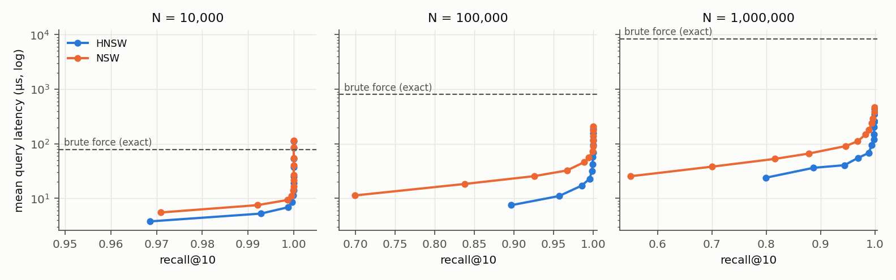
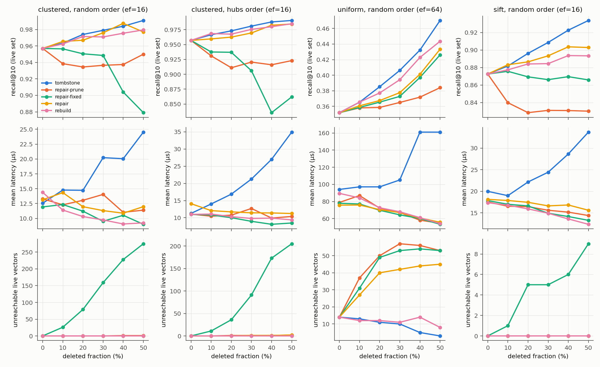
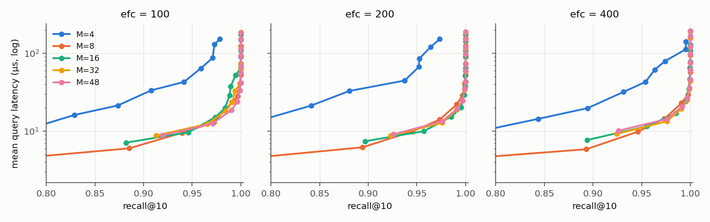
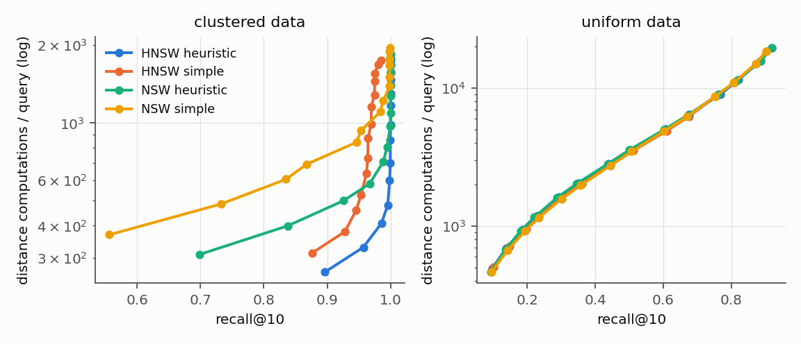

# HNSW Vector Search Engine — Phase II Report

**EE538 · Team:** Jing Ren, Zhuoshen Cheng, Ruibo Yang · **Track B** (LLM/MLSys module: retrieval index) ·
**Repository:** github.com/zhuoshen1111/HNSW-Vector-Search-Engine · **Build & test:** `make && make test`

## 1. Problem, contract and scope

Retrieval-augmented LLM systems need the *k* stored embeddings nearest to a query among millions;
exact search costs Θ(N·d) per query. We implemented **HNSW** [1] from scratch in C++17 as a
self-contained module with an exact reference, an ablation baseline (single-layer **NSW** [2]),
mutable state (insert / delete / compact), persistence and a command-line interface.

**Contract** (`include/hnsw/index.h`). Vectors come from `.fvecs`/`.csv` files with integer ids;
the metric is squared L2, cosine or negative inner product. `search(q, k, ef)` returns at most k
live `(id, distance)` pairs ordered by distance, ties broken by the smaller id in both indexes.
`add` rejects a wrong dimension, NaN/inf, a duplicate live id and (cosine) the zero vector;
`remove` rejects unknown ids; every rejected call leaves the index unchanged. Deleted ids are
never returned and may be re-added. `save`/`load` round-trips the full state, including the
level-sampling RNG. k = 0 or an empty index gives an empty answer; k > live returns all reachable
live vectors.

**Scope.** We implemented the graph, both heaps, the hash map, the visited set, quickselect, the
SIMD kernels, the serializer, the CLI, the data generator and the benchmark driver; we reuse only
the C++ standard library. hnswlib and the paper were algorithmic references (no copied code).
Non-goals: embedding models, GPUs, distributed serving, a network API, metadata filtering.

## 2. Design

**Components and ownership.** `CommandLine` owns the active index through
`std::unique_ptr<Index>`. `Index` is an abstract base (virtual `add/remove/search/compact/stats/
check_invariants/save_body`) implemented by `BruteForceIndex<Dist>` and `HNSWIndex<Dist>`; the
distance policy `Dist ∈ {L2, InnerProduct, Cosine}` is a template parameter. Runtime polymorphism
is used where indexes are interchangeable (CLI, file loader, benchmark); compile-time dispatch is
used in the inner loop, where a virtual call would cost as much as a short distance. Indexes own
all storage by value and edges are 32-bit slot numbers, so reallocation and save/load never leave
dangling references. `Index` is non-copyable; `BinaryWriter` is an RAII guard that deletes its
temporary file unless committed.

**Layout.** Each slot has its vector in a contiguous `VectorStore`, an id, a top level and a
tombstone flag. Layer 0 is one flat array with stride M0+1 (`[count, neighbours…]`); the ≈ 1/M
nodes on upper layers keep a per-node block. An `OpenHashMap<id, slot>` (linear probing, load
≤ 0.7, backward-shift deletion) maps ids to slots; an epoch-stamped `VisitedTable` resets in O(1).

**Algorithms.** (a) *Level sampling* ⌊−ln U / ln M⌋, so P(level ≥ l) = M^−l, from `mt19937_64`
with our own uniform conversion (identical graphs on every platform). (b) *Layer search*:
best-first expansion with a custom `MinHeap` frontier and a `BoundedMaxHeap` result set of size
ef; it stops when the nearest unexpanded candidate is worse than the worst result. Tombstones are
expanded but never returned. (c) *Insert*: greedy descent, an efc-wide search per layer, neighbour
selection, bidirectional links, re-selection of overflowing lists. (d) *Neighbour selection*:
*simple* keeps the M closest; the *heuristic* keeps a candidate only if it is closer to the base
point than to every kept neighbour. Inner product is not a metric: there the heuristic collapsed
the average out-degree to 1.9 and disconnected the graph, so the paper's *keepPrunedConnections*
is enabled automatically for non-metric distances (degree 18.6). (e) *Exact top-k* in the brute
force: bounded heap (default), Hoare quickselect, or full sort.

**Deletion: five designs with the same semantics.** *Tombstone* marks the node (O(1)); it stays
in the graph as a router. *Rebuild* (`compact`) re-inserts the live vectors into a fresh graph.
Three *repair* variants, after FreshDiskANN's consolidation [3], let each live neighbour u of the
deleted node x that links back to x re-select its list from N(u) ∪ N(x) with the heuristic; they
differ only in the new list length: **repair-prune** keeps what the heuristic keeps (lists can
shrink), **repair-fixed** refills with the closest pruned candidates and truncates to the old
length, and the final **repair** refills but never shrinks. Deleting the entry point elects the
highest-level live node. `stats` reports edges to tombstones and the live nodes unreachable from
the entry point on layer 0.

**Persistence.** Versioned format (magic, version, endian marker, kind, metric, dim, body,
FNV-1a checksum). Writes go to a temporary file that is renamed atomically. The loader
bounds-checks every length before allocating, validates every edge and id, runs the invariant
checker and verifies the checksum; otherwise it throws `FormatError` and the CLI keeps its index.

## 3. Complexity

N live vectors, n slots (live + tombstones), d dimensions, degree bounds M and M0 = 2M,
L = O(log N) expected layers, beam widths ef and efc, k results.

| Operation | Time | Notes |
|---|---|---|
| distance | Θ(d) | NEON processes 4 floats per instruction |
| search | expected O(L·M·d + ef·M0·(d + log ef)); worst case O(n·d) | measured distance count grows ≈ 2.3× per 10× N (§5.1) |
| insert | expected O(L·efc·M0·(d + log efc) + M0²·d) | heuristic: O(M·\|C\|) distances per list |
| delete | tombstone O(1) expected; repair O(Σ_layers M0²·d) | entry re-election O(n), only when the entry is deleted |
| compact | N inserts | reclaims tombstone memory |
| brute force | O(N·d + N log k) with the heap | quickselect: O(N·d + N + k log k) expected |
| hash map / heaps | O(1) expected (insert amortised), O(n) worst / O(log size) | load factor ≤ 0.7 |
| space | ≈ n·(4d + 4(M0 + 1) + 40) bytes + upper lists + id map | ≈ 710 B/vector at d = 128, M = 16 |

"Expected" bounds average over the random levels and the queries; HNSW has no worst-case
sub-linear guarantee.

## 4. Correctness evidence

`make test` runs 44 unit tests (own minimal framework) and two golden end-to-end scripts;
`make asan` repeats them under AddressSanitizer + UBSan (clean); macOS `leaks` reports no leaks
(LeakSanitizer is unavailable on macOS/arm64); an x86-64 AVX2 build passes under Rosetta.

* **Independent references.** `BruteForceIndex` is checked against a separate `std::sort` scan
  for every metric and top-k strategy. HNSW reaches recall@10 ≥ 0.95 at ef = 50 (L2, cosine;
  ef = 200 for inner product) and is *identical* to brute force (ids, order, distances) whenever
  ef ≥ N.
* **Invariants** (`check_invariants`, the CLI `check`, every load): array lengths; degree bounds;
  neighbour ids in range, no self-loops or duplicates, present on that layer; id map ↔ live slots
  bijection; live counter; entry point live and on the top level. Heap order and hash probe chains
  are checked after random operation sequences against `std::multiset` / `std::unordered_map`,
  including a constant hash that forces one 40-key chain.
* **State transitions.** A 6000-step seeded interleaving of inserts, deletes and queries for all
  four in-place delete policies (deleted ids never returned, invariants every 500 steps); deleting
  the entry point until the index is empty, then re-inserting; deleting the 10 % best-connected
  hubs; compaction equal to a fresh build of the survivors; save → load → identical answers for
  2 kinds × 3 metrics; insert-after-reload bit-identical; truncation at 9 offsets, a flipped byte,
  bad magic/version and trailing bytes all rejected; a failed save keeps the old file.
* **Whole application.** `tests/golden/demo.cmds` (build → query → delete → re-add → upsert →
  save/load → delete all → regrow → compact) must reproduce `demo.expected` byte for byte;
  `errors.cmds` exercises every error path (exit code 1, index unchanged).

The tests demonstrate the covered cases only; recall thresholds were calibrated on seeded data.

## 5. Experiments

**Setup.** Apple M4, 16 GB, macOS 26.6, Apple clang 21, `-O3`, NEON kernels, single-threaded
queries. Each setting gets one warm-up pass (giving recall and the distance-computation count) and
5 timed passes; we report the median of the per-pass mean latencies (standard deviations, p99 and
peak RSS are in the raw CSVs). Builds are repeated 5×/3×/1× at 10K/100K/1M. Memory is an explicit
estimate of the index structures. Data: *clustered* (64 Gaussian clusters in a 16-d latent space
mapped to d dimensions plus noise — low intrinsic dimension like embeddings), *uniform* U[0,1]^d
(adversarial) and SIFT1M [5] with its published ground truth; 1000 queries; exact ground truth
from our brute force. Defaults: M = 16, efc = 200, heuristic, k = 10, d = 128. Raw data, the
command log and the environment are in `results/full/raw/` (reproduction: Appendix B).

### 5.1 Scale, baselines and real data (E1)



| N (clustered) | index | build s | B/vector | µs at recall ≥ 0.99 (ef) | distances/query | brute force µs | speed-up |
|---|---|---|---|---|---|---|---|
| 10K | HNSW / NSW | 0.50 / 0.50 | 706 / 701 | 5.3 (16) / 7.5 (16) | 204 / 212 | 78 | 15× / 10× |
| 100K | HNSW / NSW | 7.8 / 8.1 | 719 / 714 | 22.8 (32) / 55.7 (64) | 481 / 809 | 805 | 35× / 14× |
| 1M | HNSW / NSW | 185 / 211 | 712 / 707 | 95.2 (64) / 238.8 (192) | 1108 / 2663 | 8400 | **88×** / 35× |

Brute force grows 10× per decade of N. At fixed recall HNSW's work grows ≈ 2.3× per decade and
its latency ≈ 4.2×; the extra factor is cache misses once the 0.7 GB index exceeds the caches
(p99 223 µs at 1M). Without the hierarchy (NSW) the same recall needs 2.4× more distance
computations at 1M, whereas at 10K the two are equal: the layers pay off as N grows. Memory is
≈ 710 B/vector (512 B raw vector), as estimated in the proposal. On **SIFT1M** (10,000 queries)
recall reaches 0.9895 at ef = 128 (163 µs, p99 209 µs), 0.995 at ef = 192 (231 µs, 36× faster
than brute force) and 0.997 at ef = 256 (297 µs); build 219 s. SIFT needs about 2× the ef of our clustered
data, so the generator is easier than real data, but the relative conclusions below also hold on
SIFT or on the uniform data.

### 5.2 Choosing M, efc and ef (E2–E4)

| M | B/vector | avg layer-0 degree | build s, efc 100 / 200 / 400 | µs @ 0.95 | µs @ 0.99 | µs @ 0.999 (efc 200) |
|---|---|---|---|---|---|---|
| 4 | 625 | 5.9 | 3.7 / 6.8 / 11.2 | 66.9 | not reached | not reached |
| 8 | 655 | 10.8 | 3.8 / 6.6 / 11.6 | 14.1 | 22.1 | 41.2 |
| 16 | 719 | 17.0 | 4.3 / 7.4 / 13.2 | 10.0 | 20.1 | 37.4 |
| 32 | 846 | 19.9 | 4.7 / 7.6 / 13.7 | 12.8 | 18.9 | 34.0 |
| 48 | 974 | 20.0 | 4.4 / 7.6 / 13.8 | 13.4 | 19.4 | 35.0 |

*Design question: how to set M and ef for a recall target at the lowest latency and memory.*
M = 4 is too sparse to reach 0.99 (except with efc = 400). From M = 8 upwards the latency at
recall 0.99 varies by less than 20 % (18.9–22.1 µs), but memory grows linearly in M because
layer-0 lists have a fixed stride of 2M + 1 slots, while the *used* degree saturates near 20: the
heuristic finds no more diverse neighbours in 16 intrinsic dimensions. M = 16 is the knee (within
6 % of the best latency at 0.99 with 26 % less memory than M = 48); M = 8 suits a memory budget.
efc mainly costs build time (≈ 3× from 100 to 400) and helps little beyond 200. ef is the run-time
knob: for k = 10, ef = 16/32/64 give recall 0.957/0.996/0.9995; k = 1 needs ef = 16 and k = 100
needs ef = k for 0.99 (E4). Search effort follows the *intrinsic* dimension: from d = 32 to 960
the distances needed for 0.99 only grow from 375 to 501, while latency follows the cost of one
distance (6.3 → 137 µs) (E3, Appendix A).

### 5.3 What the hierarchy and the heuristic buy (E5, E8)

On clustered data the heuristic matters most: with *simple* selection the links stay inside
clusters and HNSW plateaus at recall 0.985 even at ef = 1024; the heuristic reaches 0.95 in
10.0 µs versus 21.5 µs (HNSW-simple), 30.6 µs (NSW-heuristic) and 58.2 µs (NSW-simple). On
uniform 128-d data all four variants coincide (recall 0.92 at ef = 1024 after ≈ 19,600 distance
computations, 20 % of a scan): when the intrinsic dimension is high, distances concentrate and no
graph structure helps. L2 and cosine behave identically; inner product needs ef = 128 for 0.95 and
plateaus at 0.983, so MIPS workloads should normalise when their semantics allow (Appendix A).

### 5.4 Deletions: when does the graph need a rebuild? (E6, E7)



We delete 0–50 % of 100K vectors (random order or the highest in-degree "hubs" first) and measure
recall against exact search over the live set (figure: recall, latency and unreachable live
vectors per policy; SIFT uses its first 100K vectors).

| clustered, 50 % deleted | recall @ ef 16, random / hubs | µs @ recall ≥ 0.99, hubs | unreachable live | delete µs/op | memory |
|---|---|---|---|---|---|
| tombstone | 0.991 / 0.991 | 34.9 | 0 | 0.03 | 68.5 MB |
| repair-prune | 0.950 / 0.923 | 45.2 | 2 | 24 | 68.5 MB |
| repair-fixed | 0.879 / 0.862 | not reached (max 0.954) | **205–275** | 35 | 68.5 MB |
| **repair** (final) | 0.977 / 0.985 | 22.2 | 0–2 | 52–62 | 68.5 MB |
| rebuild | 0.980 / 0.985 | 14.5 | 0 | 0.04 + 2.7–3.1 s per rebuild | 34.3 MB |

* **Tombstones** keep recall — it even rises, because tombstones are expanded without occupying
  result slots, which silently widens the beam — but the work grows: +43 % distance computations
  (random) and +93 % (hubs) at 50 % deleted, up to 3.1× latency.
* **repair-prune** lowers the degree (17 → 15.3) and loses recall at small ef. **repair-fixed**
  shows why list length matters: truncation drops the farthest kept links, which are often the last
  in-edge of x's former neighbours; up to 275 vectors become unreachable and recall collapses.
* The final **repair** never shrinks lists: every node stays reachable and recall matches the
  rebuilt graph at equal ef, with flat latency and 52–62 µs per delete. Its degree drifts upward,
  costing ≈ 1.5–1.6× the latency of a fresh graph at equal recall but no memory (fixed stride).
  **Rebuild** gives the best graph and is the only way to reclaim memory.
* **SIFT** shows the same ordering: at 50 % deleted repair reaches 0.903 at ef = 16 versus 0.893
  for rebuild, and recall ≥ 0.95 in 26.5 µs versus 21.4 µs (rebuild) and 40–53 µs for the other
  in-place policies. Under **churn** (E7, 10 % of the data replaced per round for 10 rounds)
  tombstone latency grows 2.8×, repair-prune falls to recall 0.9645, repair keeps 0.989 and
  rebuilding every 5 rounds keeps 0.9965.

**Answer.** With tombstones alone, the extra work grows steadily (+6/12/20 % distance computations
at 10/20/30 % random deletes, +13/24/41 % for hubs), so a rebuild is due once roughly 20 % of the
graph is dead if latency matters. With the final repair the graph stays as accurate as a rebuilt
one up to 50 % deleted; rebuilding is then needed to reclaim memory (tombstones keep their vectors
and lists) and to undo the latency drift. A production system would combine repair on every delete
with background compaction.

### 5.5 Kernels and exact top-k (E9)

The NEON L2 kernel is 1.8×/3.8×/7.8× faster than the scalar loop at d = 32/128/960. For exact
top-k the bounded heap beats quickselect by 2.2–2.8× for n ≥ 100K and full sorting by 30–40×:
with small k almost every candidate is rejected after one comparison with the heap top. The
expected-O(n) algorithm loses to the O(n log k) one in practice, so the brute force uses the heap.

## 6. Limitations

* Single-threaded results on one machine; `search()` uses mutable scratch buffers, so one index
  cannot serve concurrent queries without a per-thread search context.
* Most factor sweeps use synthetic data, which is easier than SIFT; the SIFT deletion study covers
  only its first 100K vectors and random deletions.
* Repair finds in-neighbours only through the deleted node's out-neighbours; residual edges to
  tombstones remain, memory is reclaimed only by `compact`, and the degree drifts upward under heavy
  churn. Bounding that drift and choosing replacement links by in-degree is a natural Phase III
  enhancement over the reproduced FreshDiskANN-style baseline.
* Persistence guarantees a save/load round trip and never destroys the previous file, but there is
  no write-ahead log for crash recovery; inner product is supported but weak (not a metric).

## 7. Contributions and AI use

| Member | Contribution |
|---|---|
| Jing Ren | graph construction and insertion, neighbour selection (simple / heuristic / keep-pruned), level sampling, M/efc study (E2) |
| Zhuoshen Cheng | search, deletion (tombstones, repair variants, entry re-election), distance kernels, visited table and heaps, deletion and kernel studies (E6, E7, E9) |
| Ruibo Yang | `Index` interface and factory, brute-force reference and top-k, hash map, persistence, CLI, tests, data generator, benchmark driver, experiment pipeline and integration (E1, E3–E5, E8, SIFT) |

*(Edit to match the commit history.)* **AI use:** an AI coding assistant (Claude) helped draft
code, tests, scripts, figures and this report; the team reviewed, ran and verified all code and
measurements and is responsible for the content. *(State the exact extent here.)*

## References

1. Y. A. Malkov, D. A. Yashunin. Efficient and robust approximate nearest neighbor search using
   Hierarchical Navigable Small World graphs. *IEEE TPAMI* 42(4):824–836, 2020.
2. Y. Malkov, A. Ponomarenko, A. Logvinov, V. Krylov. Approximate nearest neighbor algorithm based
   on navigable small world graphs. *Information Systems* 45:61–68, 2014.
3. A. Singh, S. J. Subramanya, R. Krishnaswamy, H. V. Simhadri. FreshDiskANN: A fast and accurate
   graph-based ANN index for streaming similarity search. arXiv:2105.09613, 2021.
4. M. Douze et al. The Faiss library. arXiv:2401.08281, 2024.
5. H. Jégou, M. Douze, C. Schmid. Product quantization for nearest neighbor search. *IEEE TPAMI*
   33(1):117–128, 2011 (SIFT1M / TEXMEX corpus).
6. hnswlib, https://github.com/nmslib/hnswlib — algorithmic reference only; no code copied.

<div class="pagebreak"></div>

## Appendix A. Additional results

All numbers come from `results/full/tables.md`, generated from the raw CSVs.



**E3 — dimension** (clustered, N = 100K).

| d | build s | B/vector | µs @ 0.95 | µs @ 0.99 | brute force µs | speed-up @ 0.99 | distances/query @ 0.99 |
|---|---|---|---|---|---|---|---|
| 32 | 4.42 | 335 | 4.3 | 6.3 | 301.6 | 48× | 375 |
| 128 | 7.35 | 719 | 10.1 | 21.0 | 784.8 | 37× | 481 |
| 960 | 29.35 | 4047 | 87.7 | 136.8 | 5849.1 | 43× | 501 |

**E4 — result size k**: recall@k at the smallest ef: 0.940 (k = 1, ef 10), 0.896 (k = 10, ef 10),
0.999 (k = 100, effective ef 100); ef for recall ≥ 0.99: 16, 32 and 100 (10.5, 21.8, 57.3 µs).



**E8 — metric policies** (same vectors, exact ground truth per metric).

| metric | recall @ ef 48 | µs @ 0.95 | µs @ 0.99 | avg layer-0 degree |
|---|---|---|---|---|
| L2 | 0.999 | 9.8 | 20.5 | 17.0 |
| cosine | 0.999 | 9.8 | 19.2 | 16.8 |
| inner product | 0.912 | 51.1 | not reached (max 0.983) | 16.5 |

**E7 — churn** (50K live vectors, ef = 24, 10 rounds).

| replaced per round | policy | recall round 0 → 10 (min) | µs/query round 0 → 10 | update µs/op |
|---|---|---|---|---|
| 2 % | tombstone / repair-prune / repair / rebuild | 0.994 / 0.986 / 0.994 / 0.990 (all start at 0.9955) | 16.4 / 13.0 / 17.3 / 13.7 at round 10 | 46 / 54 / 67 / 45 |
| 10 % | tombstone | 0.9955 → 0.9970 (0.9920) | 13.5 → 37.4 | 65 |
| 10 % | repair-prune | 0.9955 → 0.9645 (0.9645) | 13.9 → 16.2 | 59 |
| 10 % | repair | 0.9955 → 0.9890 (0.9835) | 13.7 → 18.6 | 70 |
| 10 % | rebuild every 5 rounds | 0.9955 → 0.9965 (0.9920) | 13.4 → 13.6 | 55 |

**E9 — microbenchmarks** (median of 5). L2 distance, ns: d = 32: 9.3 scalar / 5.2 NEON;
d = 128: 30.0 / 7.9; d = 960: 409 / 52.8 (max relative difference 2·10⁻⁶). Exact top-10 selection,
µs: n = 100K: quickselect 347, heap 125, full sort 4618; n = 1M: 3453 / 1230 / 56740.

## Appendix B. Reproduction

```bash
make -j8 && make test && make asan                 # build, unit + golden tests, sanitizers
python3 scripts/run_experiments.py                 # all synthetic experiments (~1 h, M4)
bash scripts/download_sift.sh && python3 scripts/run_experiments.py --only sift
bash scripts/download_sift.sh --base-100k && python3 scripts/run_experiments.py --only sift_delete
python3 scripts/plot_results.py                    # figures + results/full/tables.md
python3 scripts/run_experiments.py --quick         # every experiment at reduced size (~3 min)
```

Datasets are regenerated deterministically (seed 1); every executed command is appended to
`results/full/raw/commands.log`, and the machine and compiler are recorded in `environment.txt`.
